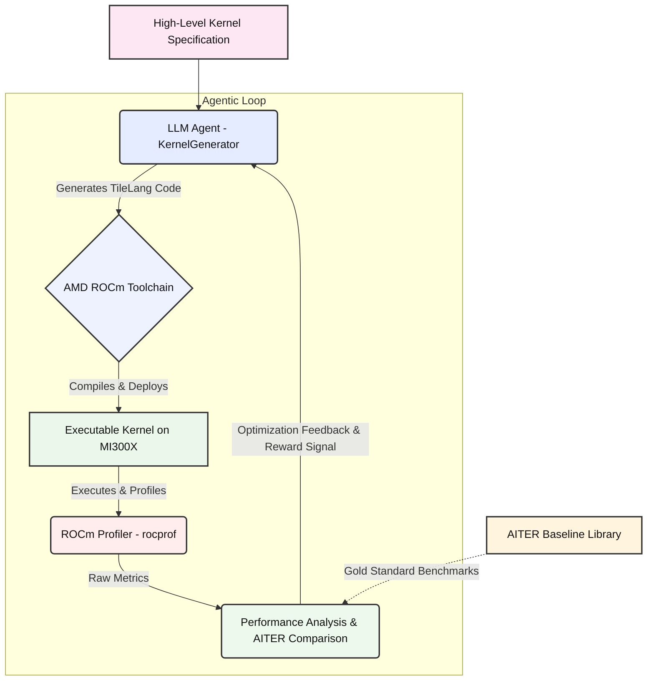

# Project AKCD: Agentic Kernel Co-Design for High-Performance Inference on AMD Instinct

## Overview

AKCD (Agentic Kernel Co-Design) is an autonomous system for optimizing GPU kernel performance on AMD Instinct hardware. By leveraging Agentic AI and Large Language Models (LLMs), AKCD automates the generation, profiling, and refinement of GPU kernels—specifically using AMD's TileLang domain-specific language—targeting the CDNA-3/4 architecture (MI300/350 series).

The core innovation is a closed "Compile-Profile-Refine" agentic loop, moving beyond manual tuning or brute-force grid searches. The system is designed to unlock the full potential of AMD Instinct GPUs for high-performance AI inference workloads.

## System Workflow

1. **High-Level Specification:** The process begins with a high-level kernel specification (e.g., matrix multiplication or other AI-relevant GPU tasks).
2. **Agentic LLM Code Generation:** An LLM-based agent generates specialized GPU kernel code in TileLang, tailored to the given task and hardware.
3. **Compilation & Deployment:** The ROCm toolchain (HIP/LLVM) compiles the generated code and deploys it to the MI300X GPU.
4. **Profiling & Metrics Collection:** During execution, ROCm's `rocprofiler` collects detailed metrics: execution time, memory bandwidth, utilization, occupancy, cache hit rates, and hardware stalls.
5. **Performance Analysis & Feedback:** These metrics are compared to the AITER baseline. Bottlenecks and inefficiencies are identified and reported back to the LLM agent.
6. **Reinforcement Learning Loop:** Using an RL system (e.g., verl), the agent receives reward signals based on performance improvements, conditioning it to generate increasingly optimized kernel code.

This loop continues iteratively, enabling the agent to autonomously explore the optimization space (tiling sizes, memory layouts, MFMA scheduling, etc.) and converge on high-performance solutions.

## Problem Space

Current inference libraries (e.g., vLLM, SGLang) rely on hand-tuned or basic autotuned kernels. TileLang has demonstrated up to 5x speedups over Triton on AMD hardware, but the optimization space is vast and complex. AKCD's agentic approach enables:

- Automated navigation of kernel design choices (tiling, LDS usage, MFMA scheduling)
- Hardware-aware code generation and profiling
- Continuous improvement via RL-driven feedback

## Research Goals

- **Autonomous TileLang Synthesis:** Develop an LLM agent that generates TileLang code from high-level mathematical specs.
- **Closed-Loop Profiling Feedback:** Integrate ROCm's `rocprofiler` to provide performance metrics as reward signals for iterative improvement.
- **Inference Bottleneck Analysis:** Use Causal AI to model and optimize latency trade-offs in vLLM's PagedAttention vs. SGLang's RadixAttention on AMD Infinity Fabric.


## Technical Stack

- **Languages:** Python (integration), C++/HIP (kernel level), TileLang (DSL)
- **Frameworks:** `verl` (RL agent training), `AITER` (AMD AI Inference Toolkit)
- **Hardware:** Instinct MI300X, MI325X, MI350/355 series

## Project Structure

```
AKCD_Project/
├── src/
│   ├── agentic_loop.py           # Orchestrates the main optimization loop
│   ├── kernel_generator.py       # LLM agent for kernel code generation
│   ├── profiling_feedback.py     # Performance metric analysis from rocprof
│   └── hardware_interface.py     # AMD hardware interaction (compilation, execution, profiling)
├── diagrams/
│   └── akcd_architecture.mmd     # Mermaid diagram of system architecture
└── README.md                     # This document
```

## System Architecture Diagram

Below is the core system architecture, visualized in Mermaid:



---

**To view or edit the diagram:** The `akcd_architecture.mmd` file can be opened in any [Mermaid](https://mermaid.js.org/) editor (e.g., [Mermaid Live Editor](https://mermaid.live/)), or viewed directly on platforms like GitHub that support `.mmd` rendering.
