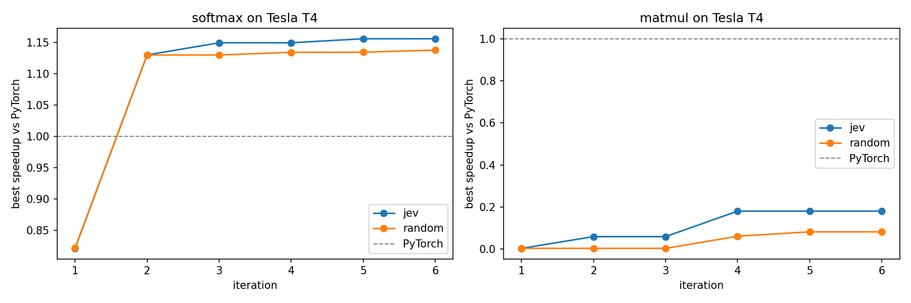
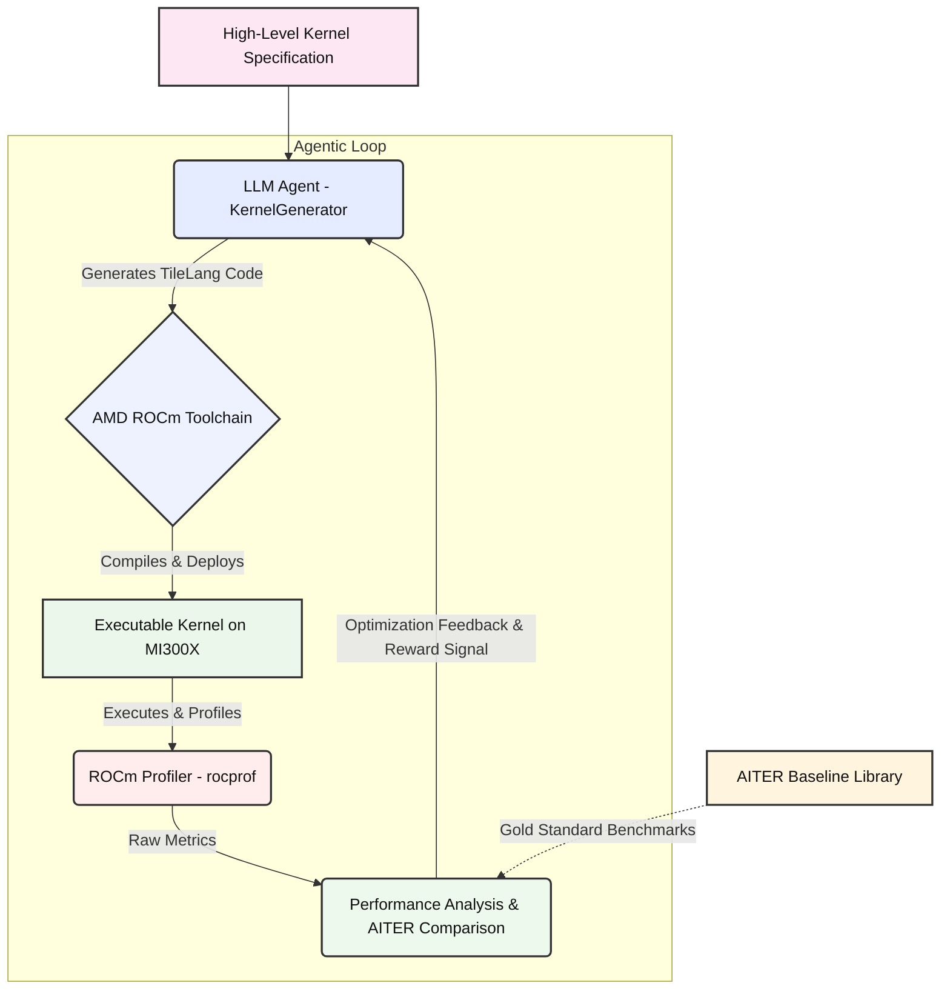

# AKO: Agentic Kernel Optimization for High-Performance Inference on AMD Instinct

## Overview


AKO (Agentic Kernel Optimization) is an autonomous system for optimizing GPU kernel performance on AMD Instinct hardware. By leveraging Agentic AI and Large Language Models (LLMs), AKO automates the generation, profiling, and refinement of GPU kernels—specifically using AMD's TileLang domain-specific language—targeting the CDNA-3/4 architecture (MI300/350 series).

The core innovation is a closed "Compile-Profile-Refine" agentic loop, moving beyond manual tuning or brute-force grid searches. The system is designed to unlock the full potential of AMD Instinct GPUs for high-performance AI inference workloads.

## Status: first real measurements (Nov 2026)

The original `src/` loop is a design prototype: its compile and profiling steps are **simulated** (random metrics). To get real numbers, [`notebooks/ako_triton_colab.ipynb`](notebooks/ako_triton_colab.ipynb) runs the loop end to end on a real GPU:

- **Generate:** an LLM (Claude Sonnet via OpenRouter) writes the kernel in **Triton**. Triton targets both NVIDIA and AMD ROCm, so the harness is portable to MI300X.
- **Verify:** every candidate runs in its own process and is checked against PyTorch with `torch.allclose`. Kernels that call the PyTorch op instead of doing the work themselves are rejected.
- **Profile:** latency with `triton.testing.do_bench`, plus achieved GB/s or TFLOPS.
- **Decide:** **Jev** (a System One decision model) picks the next move: tune the launch config, improve memory access, restructure the algorithm, or stop. A **random-move** run is the ablation.

**Results** on a Tesla T4 (Colab), 6 iterations per run, one run per policy:

| Task | Policy | Valid kernels | PyTorch | Best | Speedup | Notes |
|---|---|---|---|---|---|---|
| Softmax 4096×2048 fp32 | Jev | 5/6 | 0.322 ms | **0.279 ms** | **1.16×** | 241 GB/s, about 75% of the T4's ~320 GB/s peak |
| Softmax 4096×2048 fp32 | Random | 6/6 | 0.322 ms | 0.283 ms | 1.14× | 237 GB/s |
| Matmul 2048³ fp16 | Jev | 5/6 | 0.950 ms | 5.28 ms | 0.18× | 3.3 TFLOPS vs cuBLAS ~18 |
| Matmul 2048³ fp16 | Random | 5/6 | 0.950 ms | 11.6 ms | 0.08× | 1.5 TFLOPS |



**What this shows**
- **Softmax (memory-bound):** the loop beat PyTorch within two iterations and plateaued near the bandwidth roofline. The remaining gains are small because the kernel is limited by memory, not compute.
- **Matmul (compute-bound):** far behind cuBLAS. Even a textbook tiled `tl.dot` kernel measured 312 ms on the first try, so tensor cores are likely not being used well on this Turing GPU with this Triton build. That needs profiling before drawing conclusions. The next test is an Ampere or AMD MI300X GPU.
- **The correctness gate mattered:** it caught a softmax kernel that was fast but wrong (max error 0.046) and two matmul candidates that hung, which the subprocess timeout contained.
- **Jev vs random:** Jev's run reached slightly better kernels, but with one run per arm that's within noise. Jev's confidence was low (0.24–0.53), and it chose "tune launch config" every time. Multiple seeds are needed before claiming Jev helps.

Raw data: [`results/ako_results.csv`](results/ako_results.csv) (every attempt), [`results/ako_summary.csv`](results/ako_summary.csv), and the winning kernels in [`results/kernels/`](results/kernels/).

**Next:** run on an AMD MI300X (ROCm), use 3+ seeds per policy, add a rocprof/Nsight profile of the matmul gap, and feed hardware counters to Jev instead of latency alone.

## System Workflow

1. **High-Level Specification:** The process begins with a high-level kernel specification (e.g., matrix multiplication or other AI-relevant GPU tasks).
2. **Agentic LLM Code Generation:** An LLM-based agent generates specialized GPU kernel code in TileLang, tailored to the given task and hardware.
3. **Compilation & Deployment:** The ROCm toolchain (HIP/LLVM) compiles the generated code and deploys it to the MI300X GPU.
4. **Profiling & Metrics Collection:** During execution, ROCm's `rocprofiler` collects detailed metrics: execution time, memory bandwidth, utilization, occupancy, cache hit rates, and hardware stalls.
5. **Performance Analysis & Feedback:** These metrics are compared to the AITER baseline. Bottlenecks and inefficiencies are identified and reported back to the LLM agent.
6. **Reinforcement Learning Loop:** Using an RL system (e.g., verl), the agent receives reward signals based on performance improvements, conditioning it to generate increasingly optimized kernel code.

This loop continues iteratively, enabling the agent to autonomously explore the optimization space (tiling sizes, memory layouts, MFMA scheduling, etc.) and converge on high-performance solutions.

## Problem Space

Current inference libraries (e.g., vLLM, SGLang) rely on hand-tuned or basic autotuned kernels. TileLang has demonstrated up to 5x speedups over Triton on AMD hardware, but the optimization space is vast and complex. AKO's agentic approach enables:

- Automated navigation of kernel design choices (tiling, LDS usage, MFMA scheduling)
- Hardware-aware code generation and profiling
- Continuous improvement via RL-driven feedback

## Research Goals

- **Autonomous TileLang Synthesis:** Develop an LLM agent that generates TileLang code from high-level mathematical specs.
- **Closed-Loop Profiling Feedback:** Integrate ROCm's `rocprofiler` to provide performance metrics as reward signals for iterative improvement.
- **Inference Bottleneck Analysis:** Use Causal AI to model and optimize latency trade-offs in vLLM's PagedAttention vs. SGLang's RadixAttention on AMD Infinity Fabric.


## Technical Stack

- **Languages:** Python (integration), C++/HIP (kernel level), TileLang (DSL)
- **Frameworks:** `verl` (RL agent training), `AITER` (AMD AI Inference Toolkit)
- **Hardware:** Instinct MI300X, MI325X, MI350/355 series

## Project Structure

```
AKO_Project/
├── src/
│   ├── agentic_loop.py           # Orchestrates the main optimization loop
│   ├── kernel_generator.py       # LLM agent for kernel code generation
│   ├── profiling_feedback.py     # Performance metric analysis from rocprof
│   └── hardware_interface.py     # AMD hardware interaction (compilation, execution, profiling)
├── diagrams/
│   └── ako_architecture.mmd      # Mermaid diagram of system architecture
└── README.md                     # This document
```

## System Architecture Diagram


Below is the core system architecture, visualized in Mermaid:



---

**To view or edit the diagram:** The `ako_architecture.mmd` file can be opened in any [Mermaid](https://mermaid.js.org/) editor (e.g., [Mermaid Live Editor](https://mermaid.live/)), or viewed directly on platforms like GitHub that support `.mmd` rendering.
